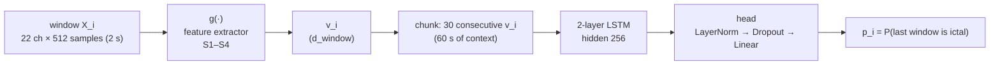

# A Comparative Study of Feature Extractors for Epileptic Seizure Detection

Code for the Bachelor's thesis (TFG) of **Marc Cases Font**, Bachelor's Degree in Data Engineering, Universitat Autònoma de Barcelona (UAB), carried out at the Centre de Visió per Computador (CVC).

📄 **Paper:** [`docs/TFG_MarcCases.pdf`](docs/TFG_MarcCases.pdf)

This study asks one design question: **how does the way raw EEG is turned into features affect a deep-learning seizure detector?** Instead of proposing a new end-to-end system, the downstream classifier (a shared LSTM) and the whole training pipeline are held fixed, and only the window-level feature extractor `g(·)` changes. Four extractors (S1–S4) are compared on the CHB-MIT scalp-EEG database under three cross-validation protocols of increasing strictness, from a permissive split that mixes data from the same patient to a fully patient-independent (leave-subjects-out) split.

---

## Contents

- [Key results](#key-results)
- [Method overview](#method-overview)
- [Terminology: paper vs. code](#terminology-paper-vs-code)
- [Repository structure](#repository-structure)
- [Setup](#setup)
- [Running the experiments](#running-the-experiments)
- [Outputs](#outputs)
- [Implementation details](#implementation-details)
- [Reproducibility notes](#reproducibility-notes)
- [Citation](#citation)

---

## Key results

**The validation protocol dominates the reported performance.** The raw baseline S1 is the *best* model when highly overlapping chunks can fall in both training and validation (by chunk), and the *worst* on unseen patients (by patient). Under the patient-independent protocol, the per-channel CNN and the inter-channel Transformer each improve on S1, and their combination (S4) gives the best recall and F1.

F1 (%), mean ± std across the 5 folds, last epoch:

| Strategy | by chunk | by recording | by patient |
|---|---|---|---|
| S1 — raw + flatten | **95.89 ± 1.27** | 23.00 ± 5.65 | 16.83 ± 10.18 |
| S2 — CNN + flatten | 92.34 ± 2.79 | **79.08 ± 6.55** | 46.62 ± 8.80 |
| S3 — raw + Transformer | 80.91 ± 7.81 | 59.27 ± 6.25 | 47.05 ± 5.70 |
| S4 — CNN + Transformer | 85.62 ± 4.61 | 76.88 ± 9.52 | **60.53 ± 18.92** |

Patient-independent protocol (k-fold by patient, Table VII of the paper):

| Strategy | Recall | Precision | Specificity | F1 |
|---|---|---|---|---|
| S1 — raw + flatten | 12.12 ± 8.74 | 37.25 ± 13.75 | **98.29 ± 0.75** | 16.83 ± 10.18 |
| S2 — CNN + flatten | 53.86 ± 15.64 | 51.97 ± 28.73 | 91.30 ± 9.42 | 46.62 ± 8.80 |
| S3 — raw + Transformer | 57.40 ± 17.77 | 46.80 ± 17.31 | 92.40 ± 4.84 | 47.05 ± 5.70 |
| S4 — CNN + Transformer | **78.90 ± 13.54** | **57.11 ± 28.88** | 88.79 ± 15.18 | **60.53 ± 18.92** |

<details>
<summary>Full fold-level tables for the other two protocols (Tables V and VI)</summary>

**k-fold by chunk** (Table V, most optimistic):

| Strategy | Recall | Precision | Specificity | F1 |
|---|---|---|---|---|
| S1 — raw + flatten | **98.07 ± 1.36** | **93.86 ± 2.75** | **99.34 ± 0.31** | **95.89 ± 1.27** |
| S2 — CNN + flatten | 97.20 ± 1.23 | 88.15 ± 5.91 | 98.64 ± 0.75 | 92.34 ± 2.79 |
| S3 — raw + Transformer | 96.40 ± 2.44 | 70.67 ± 12.60 | 95.57 ± 2.66 | 80.91 ± 7.81 |
| S4 — CNN + Transformer | 89.40 ± 2.67 | 82.86 ± 9.68 | 97.98 ± 1.52 | 85.62 ± 4.61 |

**k-fold by recording** (Table VI, intermediate strictness):

| Strategy | Recall | Precision | Specificity | F1 |
|---|---|---|---|---|
| S1 — raw + flatten | 14.10 ± 3.36 | 64.14 ± 20.37 | **99.20 ± 0.43** | 23.00 ± 5.65 |
| S2 — CNN + flatten | 80.88 ± 7.65 | **78.93 ± 12.48** | 97.66 ± 1.85 | **79.08 ± 6.55** |
| S3 — raw + Transformer | 57.35 ± 8.05 | 65.73 ± 17.92 | 96.15 ± 3.25 | 59.27 ± 6.25 |
| S4 — CNN + Transformer | **89.18 ± 6.26** | 69.76 ± 16.01 | 95.29 ± 3.86 | 76.88 ± 9.52 |

</details>

The per-patient metrics of every strategy and protocol are in Appendix B of the paper (Tables IX–XI).

---

## Method overview

### Shared pipeline

Every strategy shares the same pipeline (Fig. 1 of the paper). Only the feature extractor `g(·)` changes.



- **Data:** CHB-MIT, 24 cases, 22 bipolar channels (Table I), 256 Hz. Each recording is z-scored per channel over the whole recording, then cut into non-overlapping 2 s **windows**.
- **Labels:** ictal (1) vs. interictal (0). A 5 min preictal buffer (SPH = 0, SOP = 5 min) and a 5 min postictal buffer are excluded as targets. They can still appear as context inside a chunk.
- **Samples:** a **chunk** is a sequence of N = 30 consecutive windows, labelled with its last window. Ictal chunks use stride 1, so the scarce positive class is sampled densely. Interictal chunks use stride 30, so they do not overlap.
- **Classifier:** a 2-layer LSTM (hidden 256) whose last hidden state goes through LayerNorm → Dropout → Linear(256 → 1).

### Feature extractors

The four evaluated strategies sit on two orthogonal axes (Table III):

| | **Flatten** | **Transformer + CLS** |
|---|---|---|
| **No compressor (raw)** | **S1** · d_window = 11 264 | **S3** · d_window = 128 |
| **Supervised CNN** | **S2** · d_window = 1 408 | **S4** · d_window = 128 |
| *Self-supervised AE* | *S5 · 2 816 (deferred)* | *S6 · 128 (deferred)* |

- **S1 — raw + flatten** (Sec. VI-D). This is the baseline: no extractor. The 22 × 512 window is flattened in canonical channel order.
- **S2 — CNN + flatten** (Sec. VI-E). A small 1D CNN with weights shared across channels (Table IV) turns each channel into a 64-d descriptor. The 22 descriptors are concatenated.
- **S3 — raw + Transformer** (Sec. VI-F). Each raw channel (512 samples) is a token. A learnable CLS token is prepended, every token is projected to 128 dimensions, and a 4-layer pre-norm Transformer encoder mixes them. There is no channel embedding.
- **S4 — CNN + Transformer** (Sec. VI-G). The S2 CNN produces 22 descriptors, which become tokens for the S3 Transformer.

S5 and S6 (self-supervised autoencoder encoders) are described in the paper but are **not implemented** in this repository; they are deferred to a later iteration.

### Validation protocols

All three protocols use K = 5 folds and differ only in the grouping unit (Sec. VII-A):

| Protocol | Grouping unit | What it measures | Scripts | Paper tables |
|---|---|---|---|---|
| **k-fold by chunk** | chunk | held-out chunks from seen recordings. Nearly identical ictal chunks can fall in both sets, so this is an optimistic upper bound | `experiments/1_by_chunk/` | V, IX |
| **k-fold by recording** | EDF file | new recordings of already-seen patients | `experiments/2_by_recording/` | VI, X |
| **k-fold by patient** (leave-subjects-out) | patient | unseen patients, the clinically relevant regime | `experiments/3_by_patient/` | VII, XI |

In every fold, the training set is balanced to 1:1 by subsampling interictal chunks. The validation set is **not** rebalanced, so interictal chunks remain the majority.

---

## Terminology: paper vs. code

The scripts are kept **exactly as they were run** for the paper, so their identifiers, log messages and output file names still use the original internal naming. That naming swaps the meaning of *chunk* and *window* relative to the paper. The comments and docstrings in the scripts use the paper's terminology. Keep this mapping in mind when reading the code:

| Paper | Meaning | In the code |
|---|---|---|
| **window** | 2 s segment, 22 channels × 512 samples | "chunk": `CHUNK_SEC`, `tchunk`, `chunkify()`, `label_single_chunk()` |
| **chunk** | N = 30 consecutive windows (60 s), labelled by its last window | "ventana" / window: `WINDOW = 30`, `RawWindowDataset` |
| chunk stride (ictal / interictal) | 1 / 30 windows | `STRIDE_WIN` / `STRIDE_WIN_INTERICTAL` |
| strategy **SN** | feature extractor *N* | `casuisticaN` in output names, W&B runs and configs |
| d_window | size of v_i | `lstm_input` |
| protocol by chunk / recording / patient | k-fold grouping unit | `SPLIT = "chunk"` / `"recording"` / `"patient"` |

---

## Repository structure

```
.
├── README.md
├── requirements.txt
├── data/
│   └── README.md                 # how to obtain CHB-MIT and the seizure manifest
├── docs/
│   └── TFG_MarcCases.pdf         # the paper
└── experiments/
    ├── 1_by_chunk/               # k-fold by chunk      → Tables V and IX
    │   ├── s1_raw_flatten.py
    │   ├── s2_cnn_flatten.py
    │   ├── s3_raw_transformer.py
    │   └── s4_cnn_transformer.py
    ├── 2_by_recording/           # k-fold by recording  → Tables VI and X
    │   └── (same four scripts)
    └── 3_by_patient/             # k-fold by patient    → Tables VII and XI
        └── (same four scripts)
```

Each of the 12 scripts is **self-contained** and trains one strategy under one protocol (5 folds × 30 epochs). The scripts share all of their code except two parts:
- the feature extractor `g(·)`, which is the same in every protocol folder;
- the k-fold split function, which is the same for every strategy.

Every script begins with a docstring that summarises its strategy, protocol and the paper tables it produces.

---

## Setup

### Environment

Python ≥ 3.9 and a CUDA GPU are recommended.

```bash
# install the PyTorch build that matches your CUDA version first: https://pytorch.org
pip install -r requirements.txt
```

### Data

The scripts need two inputs. Both are described in detail in [`data/README.md`](data/README.md):

1. **CHB-MIT Scalp EEG Database v1.0.0**, downloaded from PhysioNet. This is the folder that contains `chb01/ … chb24/`.
2. **A seizure manifest** (`seizures_manifest.csv`) with one row per seizure: `patient, edf, seizure_idx, start_sec, end_sec`.

### Paths

The paths are set at the top of every script, in the `CONFIG` block, and still point to the machine where the experiments were run. Edit them before running:

```python
DATA_ROOT    = Path(r".../chb-mit-scalp-eeg-database-1.0.0")
SEIZURES_CSV = Path(r".../seizures_manifest.csv")
```

### Weights & Biases

Every script logs to W&B in the project `TFG-seizure-embeddings`. Either run `wandb login` first, or run offline with `WANDB_MODE=offline`.

---

## Running the experiments

Run any script from the repository root. Outputs go to the current working directory.

```bash
# one experiment: S4 (CNN + Transformer) under the patient-independent protocol
python experiments/3_by_patient/s4_cnn_transformer.py

# the full study (12 runs)
for protocol in 1_by_chunk 2_by_recording 3_by_patient; do
  for strategy in s1_raw_flatten s2_cnn_flatten s3_raw_transformer s4_cnn_transformer; do
    python experiments/$protocol/$strategy.py
  done
done
```

How each protocol loads the data:
- **by chunk** and **by recording** build the full pool of chunks once (every EDF loaded and windowed into RAM), then split it by index in each fold.
- **by patient** builds the training and validation datasets inside each fold, from that fold's patients.

---

## Outputs

Every run writes four CSV files, the last-epoch checkpoint of every fold, and W&B runs. `<prefix>` depends on the strategy (see the table below), and `<split>` is `chunk`, `recording` or `patient`.

| Output | Content |
|---|---|
| `eval_<prefix>_per_epoch_…_kfold_<split>.csv` | train and validation metrics of every epoch of every fold (`fold, epoch, split, loss, acc, f1, recall, precision, specificity, tp, tn, fp, fn`) |
| `eval_<prefix>_per_epoch_agg_…_kfold_<split>.csv` | mean ± std across folds for every epoch (learning curves) |
| `eval_<prefix>_kfold_summary_…_<split>.csv` | last-epoch metrics of every fold, plus `mean` and `std` rows. This is the strategy's row in **Tables V–VII** |
| `eval_<prefix>_per_patient_…_kfold_<split>.csv` | last-epoch metrics per patient, plus `mean` and `std` rows across patients. These are the strategy's columns in **Tables IX–XI** |
| `checkpoints_…_<split>/last_fold<k>.pt` | model and optimizer state at epoch 30, validation metrics and config |
| W&B | one run per fold plus a `_summary` run (per-fold table, per-patient table, mean ± std curves, CSVs as an artifact), grouped by run name |

| Strategy | CSV prefix | Checkpoint folder |
|---|---|---|
| S1 | `eval_raw_plain_lstm_*_casuistica1_*` | `checkpoints_raw_plain_lstm_casuistica1_ictal_<split>/` |
| S2 | `eval_raw_lstm_window_*_casuistica2_*` | `checkpoints_raw_plain_lstm-withCNN_casuistica2_ictal_<split>/` |
| S3 | `eval_raw_channel_transformer_*_casuistica3_*` | `checkpoints_raw_channel_transformer_casuistica3_ictal_<split>/` |
| S4 | `eval_cnn_channel_transformer_*_casuistica4_*` | `checkpoints_cnn_channel_transformer_casuistica4_ictal_<split>/` |

The validation metrics are computed at the window level of the paper, that is, one prediction per chunk for its last window, with a decision threshold of 0.5.

---

## Implementation details

### Shared by all strategies

| Element | Value |
|---|---|
| Window | L = 2 s, 22 × 512 samples at 256 Hz, no overlap |
| Chunk | N = 30 windows (60 s). Stride 1 window for ictal chunks, 30 windows for interictal chunks |
| Labelling | SPH = 0 min, SOP = 5 min (preictal buffer), 5 min postictal buffer |
| Normalisation | per-channel, per-recording z-score (ε = 1e-8), applied before windowing |
| LSTM | 2 layers, hidden size 256, dropout 0.3 between layers |
| Head | LayerNorm → Dropout(0.3) → Linear(256 → 1) |
| Loss | `BCEWithLogitsLoss`, `pos_weight = n_interictal / n_ictal` of the training set (≈ 1 after balancing) |
| Optimiser | Adam, learning rate 1e-3, weight decay 1e-3, constant learning rate (no scheduler) |
| Batch size | 128 chunks |
| Gradient clipping | max norm 1.0 |
| Epochs / model selection | 30 epochs. The metrics and checkpoint come from the last epoch, not the best one |
| Cross-validation | K = 5, seed 123 (fold assignment, training subsampling and model initialisation, which is identical in every fold) |
| Class balancing | training set: interictal chunks subsampled to 1:1. Validation set: not rebalanced |

### Strategy-specific

**Per-channel CNN** (S2, S4; Table IV). It is applied to each channel of each window with shared weights:

| Block | Channels | Kernel | Pool |
|---|---|---|---|
| Conv1d + BatchNorm + GELU | 1 → 16 | 7 | MaxPool(4) |
| Conv1d + BatchNorm + GELU | 16 → 32 | 5 | MaxPool(2) |
| Conv1d + BatchNorm + GELU | 32 → 64 | 3 | — |
| Global average pooling | 64 | — | — |
| Dropout(0.1) + Linear | 64 → 64 | — | — |

**Inter-channel Transformer** (S3, S4):
- **Tokens:** a learnable CLS token plus the 22 channel tokens. In S3 these are the raw 512-sample channels; in S4 they are the 64-d CNN descriptors. A linear layer projects every token to d_model = 128.
- **Encoder:** 4 pre-norm layers, 4 heads, feed-forward dimension 512, GELU, dropout 0.1.
- **No channel embedding:** the channels are treated as an unordered set.
- **Output:** the window representation v_i is the CLS output followed by a final LayerNorm.

---

## Reproducibility notes

- **Seeds.** Python, NumPy and PyTorch are seeded with `SEED = 123`. cuDNN is not forced into deterministic mode, so GPU runs can differ slightly from run to run.
- **Last-epoch reporting.** All reported metrics come from epoch 30, not from the best validation epoch. The paper (Sec. VII-C) explains why.
- **Per-patient F1 convention.** In the per-patient CSV, F1 is `NaN` whenever a patient has TP = 0, and `NaN` values are left out of the mean ± std across patients. In the per-patient tables of the paper (IX–XI), patients with precision = recall = 0 are reported with F1 = 0 and **are included** in the mean ± std. To reproduce the means in the paper, set those F1 values to 0 before averaging.
- **Excluded recordings.** EDF files that lack any of the 22 canonical channels are skipped while the dataset is built. Each skip is printed as `[skip] <file>`.
- **Memory.** The by-chunk and by-recording scripts keep the whole windowed dataset in RAM as float32, which takes several tens of GB for the full CHB-MIT database.

---

## Citation

If you use this code, please cite the thesis:

```bibtex
@misc{cases2026featureextractors,
  author       = {Cases Font, Marc},
  title        = {A Comparative Study of Feature Extractors for Epileptic Seizure Detection},
  howpublished = {Bachelor's thesis, Universitat Aut{\`o}noma de Barcelona (UAB), Centre de Visi{\'o} per Computador (CVC)},
  year         = {2026}
}
```

Please also cite the CHB-MIT database and PhysioNet:

- A. H. Shoeb, *Application of machine learning to epileptic seizure onset detection and treatment*, Ph.D. dissertation, MIT, 2009.
- A. L. Goldberger et al., "PhysioBank, PhysioToolkit, and PhysioNet: Components of a new research resource for complex physiologic signals," *Circulation*, vol. 101, no. 23, 2000.
- J. Guttag, "CHB-MIT Scalp EEG Database (version 1.0.0)," PhysioNet, 2010. doi: [10.13026/C2K01R](https://doi.org/10.13026/C2K01R).

The validation methodology follows D. Gil and A. Hernández-Sabaté, "What is the across-subject performance of your Artificial Intelligence method for EEG analysis?," *Biomedical Signal Processing and Control*, vol. 120, p. 110020, 2026.
