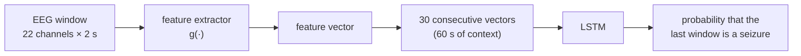

# A Comparative Study of Feature Extractors for Epileptic Seizure Detection

**Bachelor's thesis (TFG)** · Marc Cases Font · Bachelor's Degree in Data Engineering, Universitat Autònoma de Barcelona (UAB) · Centre de Visió per Computador (CVC)

📄 Read the paper: [`docs/TFG_MarcCases.pdf`](docs/TFG_MarcCases.pdf)

---

## About the project

Epilepsy affects around 50 million people worldwide, and about one third of patients keep having seizures despite medication. Patients are often monitored with an **electroencephalogram (EEG)**, which records brain activity through electrodes placed on the scalp. These recordings can last for hours or days, while a seizure may last only a few seconds. Today, finding those seconds usually means a specialist reading the recording by eye, which is slow, expensive and error-prone. **Automatic seizure detection** aims to do this job with a computer.

Any detection system has to turn the raw EEG signal into a compact set of features that a classifier can work with. This project focuses on that one step: **how the choice of feature extractor affects the performance of a deep-learning seizure detector.**

Most published work presents a complete system end to end, which makes it hard to tell which design choice is responsible for the results. Instead, this project runs a **controlled comparison**:

- The classifier, the data processing and the training procedure are the same for every experiment.
- Only the feature extractor changes, so any difference in performance can be traced back to it.

A second goal is to check **how trustworthy the evaluation is**. Results in this field are easily inflated when data from the same patient ends up in both the training and the test set. For that reason, every extractor is evaluated under three validation protocols of increasing strictness. The strictest one tests the model only on patients it has never seen during training.

All experiments use the public [CHB-MIT Scalp EEG Database](https://physionet.org/content/chbmit/1.0.0/).

---

## How it works

### From EEG to a prediction



1. **Pre-processing.** Each recording keeps 22 standard EEG channels, sampled at 256 Hz. Each channel is normalised (z-score) over the whole recording.
2. **Windows.** The signal is cut into consecutive, non-overlapping **windows** of 2 seconds, each 22 channels × 512 samples.
3. **Feature extraction.** A feature extractor `g(·)` turns each window into a feature vector. **This is the only part that changes between experiments.**
4. **Classification.** A **chunk** of 30 consecutive windows (60 s of context) is fed, as a sequence of feature vectors, to a shared two-layer LSTM. The LSTM outputs the probability that the **last window** of the chunk is ictal, that is, part of a seizure.

**Labels.** The task is binary: *ictal* (seizure, 1) vs. *interictal* (normal background activity, 0). The 5 minutes before and the 5 minutes after each seizure are transition periods. They are never used as targets, but they can appear as context inside a chunk.

### The four feature extractors

The extractors are organised along two independent design choices:
- whether each channel is first compressed by a small neural network;
- whether the channels are mixed with an attention mechanism.

| | Channels concatenated (flatten) | Channels mixed by a Transformer |
|---|---|---|
| **Raw signal** | **S1 — raw + flatten** | **S3 — raw + Transformer** |
| **Per-channel CNN** | **S2 — CNN + flatten** | **S4 — CNN + Transformer** |

- **S1 — raw + flatten.** This is the baseline, with no feature extraction at all. The raw window is flattened into one long vector, and the LSTM has to learn everything by itself.
- **S2 — CNN + flatten.** A small 1D convolutional network, shared by all channels, summarises each channel into 64 values. The 22 summaries are then concatenated.
- **S3 — raw + Transformer.** Each channel is treated as a *token*, and a Transformer encoder mixes the information across channels through self-attention. The output of a special summary token (CLS) represents the window.
- **S4 — CNN + Transformer.** This combines both ideas: the CNN of S2 summarises each channel, and the Transformer of S3 mixes the resulting summaries.

Comparing pairs isolates each design choice. S1 → S2 and S3 → S4 measure the effect of the per-channel CNN. S1 → S3 and S2 → S4 measure the effect of the Transformer.

The paper also describes two further variants based on a self-supervised autoencoder (S5, S6). They are planned for future work and are not part of this repository.

---

## Validation protocols: how the data is partitioned

### Cross-validation in a nutshell

Every experiment uses **5-fold cross-validation**:
1. The data is divided into 5 groups, called *folds*.
2. The model is trained 5 times from scratch, always starting from the same initial weights. Each time, one fold is held out for validation and the other four are used for training.
3. In the end, every sample has been used for validation exactly once. The results are reported as the **mean ± standard deviation over the 5 folds**.

The important question is **which unit is assigned to a fold**. EEG data is strongly structured:
- each patient has several recordings;
- each recording contains many chunks;
- consecutive chunks overlap in time.

If closely related data ends up on both sides of the split, the model is tested on something almost identical to what it learned from, and the score no longer reflects how it would perform in practice. The three protocols differ **only** in this unit. They go from the most permissive to the strictest, so comparing them shows how much the reported performance depends on the evaluation.

Only *valid* chunks are partitioned. A chunk is valid when its last window is ictal or interictal.

### An illustration

Imagine two patients with two recordings each. Every digit below is one chunk, and its value is the fold in which that chunk is used for **validation**. In the other four folds, the same chunk is used for training.

```
                    Patient chb01                    Patient chb02
                recording 1    recording 2      recording 1    recording 2

By chunk        3 1 5 2 4 1    2 5 3 4 1 2      4 2 1 5 3      1 3 5 2 4    ← every chunk is assigned on its own
By recording    2 2 2 2 2 2    5 5 5 5 5 5      1 1 1 1 1      3 3 3 3 3    ← a whole recording goes to one fold
By patient      4 4 4 4 4 4    4 4 4 4 4 4      1 1 1 1 1      1 1 1 1 1    ← a whole patient goes to one fold
```

### Protocol 1 — By chunk

- **How it is built.** The valid chunks of every patient and recording are pooled together. The pool is shuffled with a fixed random seed and dealt into 5 folds of about 20 % each, so each fold is an 80/20 split. The patient and the recording a chunk comes from are ignored.
- **What can leak.** Every patient, and almost every recording, appears in both training and validation. Worse, seizure chunks are extracted at every window (stride 1), so two consecutive seizure chunks share 29 of their 30 windows. One of them can be in the training set while its near-copy is in the validation set.
- **What it measures.** How well the model recognises data that is almost the same as data it has already seen. This protocol is an **optimistic upper bound**, not a realistic estimate.

### Protocol 2 — By recording

- **How it is built.** The unit is the recording, that is, one EDF file. The recordings that contain at least one valid chunk are shuffled with a fixed seed and dealt into 5 folds. All the chunks of a recording always go to the same fold. The patient is ignored.
- **What can leak.** No recording is split between training and validation, so the overlap between neighbouring chunks no longer leaks. However, a patient usually has several recordings, and they are spread over different folds. The model is therefore validated on new recordings of patients it has already been trained on. A patient is not guaranteed to appear in the validation set of every fold, and the folds are balanced in number of recordings, not in number of seizures.
- **What it measures.** How well the model generalises to **new recordings of known patients**. Its strictness is intermediate.

### Protocol 3 — By patient (leave-subjects-out)

- **How it is built.** The unit is the patient, that is, one case folder `chb01` … `chb24`. The 24 patients are shuffled with a fixed seed and dealt into 5 groups of 5, 5, 5, 5 and 4 patients. In each fold:
  - all the recordings of one group are the validation set;
  - all the recordings of the remaining 19–20 patients are the training set.
- **What can leak.** Nothing between patients: no patient is ever in both sets. Each patient is validated exactly once, by a model that never saw them during training.
- **What it measures.** How well the model works on **new patients**, which is the realistic clinical scenario. The main conclusions of the project are drawn from this protocol.

### Side by side

| | By chunk | By recording | By patient |
|---|---|---|---|
| Unit assigned to a fold | chunk | recording (EDF file) | patient |
| Nearly identical chunks in training and validation | possible | no | no |
| Same recording in training and validation | yes | no | no |
| Same patient in training and validation | yes | yes | no |
| Measures generalisation to… | data already seen | new recordings | new patients |
| Strictness | lowest | intermediate | highest |

### What happens inside each fold

- **Training set: balanced.** Normal (interictal) chunks far outnumber seizure (ictal) chunks. Normal chunks are therefore randomly discarded, with a fixed seed, until there is one per seizure chunk.
- **Validation set: not rebalanced.** All seizure chunks and all normal chunks are kept, so normal activity remains the majority class. Normal chunks never overlap with each other, while seizure chunks are sampled at every window.
- **Training and evaluation.** The model is trained for 30 epochs and evaluated with the weights of the last epoch.
- **Per-patient metrics.** They are built from each patient's validation chunks:
  - **by patient:** a patient appears in a single fold, so their metrics come from that fold;
  - **by chunk and by recording:** a patient's validation chunks are spread over the 5 folds, so their confusion matrices are summed across folds. Each chunk is still counted exactly once.

---

## Results

The models are compared with four metrics:
- **recall (sensitivity):** the fraction of seizure windows that are detected. It is the most important metric clinically, because a missed seizure is the costliest error.
- **precision**
- **specificity**
- **F1:** the single summary score used to compare models.

### Main findings

1. **The validation protocol matters more than the model.** The raw baseline S1 looks like the best model when the evaluation is permissive (F1 = 95.9 by chunk). It becomes the worst once it is tested on unseen patients (F1 = 16.8 by patient).
2. **Both design choices help on unseen patients.** Adding a per-channel CNN improves results, and so does adding the Transformer. S4, which combines both, is the best model: recall 78.9 and F1 60.5 by patient.
3. **Performance varies a lot from patient to patient.** Some patients are detected almost perfectly. In others, the model either misses most seizures or produces too many false alarms.

### F1 score under each protocol

Mean ± standard deviation across the 5 folds, in %:

| Strategy | By chunk | By recording | By patient |
|---|---|---|---|
| S1 — raw + flatten | **95.89 ± 1.27** | 23.00 ± 5.65 | 16.83 ± 10.18 |
| S2 — CNN + flatten | 92.34 ± 2.79 | **79.08 ± 6.55** | 46.62 ± 8.80 |
| S3 — raw + Transformer | 80.91 ± 7.81 | 59.27 ± 6.25 | 47.05 ± 5.70 |
| S4 — CNN + Transformer | 85.62 ± 4.61 | 76.88 ± 9.52 | **60.53 ± 18.92** |

### Unseen patients (by-patient protocol)

| Strategy | Recall | Precision | Specificity | F1 |
|---|---|---|---|---|
| S1 — raw + flatten | 12.12 ± 8.74 | 37.25 ± 13.75 | **98.29 ± 0.75** | 16.83 ± 10.18 |
| S2 — CNN + flatten | 53.86 ± 15.64 | 51.97 ± 28.73 | 91.30 ± 9.42 | 46.62 ± 8.80 |
| S3 — raw + Transformer | 57.40 ± 17.77 | 46.80 ± 17.31 | 92.40 ± 4.84 | 47.05 ± 5.70 |
| S4 — CNN + Transformer | **78.90 ± 13.54** | **57.11 ± 28.88** | 88.79 ± 15.18 | **60.53 ± 18.92** |

The paper contains the complete tables for all three protocols and the results for every individual patient.

---

## Repository structure

```
.
├── README.md
├── requirements.txt
├── data/
│   └── README.md                 # how to get the dataset and the seizure annotations
├── docs/
│   └── TFG_MarcCases.pdf         # the paper
└── experiments/
    ├── 1_by_chunk/               # protocol 1: split by chunk
    │   ├── s1_raw_flatten.py
    │   ├── s2_cnn_flatten.py
    │   ├── s3_raw_transformer.py
    │   └── s4_cnn_transformer.py
    ├── 2_by_recording/           # protocol 2: split by recording (same four scripts)
    └── 3_by_patient/             # protocol 3: split by patient (same four scripts)
```

Each script is self-contained. It trains and evaluates one feature extractor under one validation protocol: 5 folds × 30 epochs.

---

## Getting started

### 1. Install the dependencies

Python 3.9 or later is required, and a CUDA-capable GPU is strongly recommended.

```bash
# install the PyTorch build that matches your CUDA version first: https://pytorch.org
pip install -r requirements.txt
```

### 2. Get the data

Download the CHB-MIT database and prepare the seizure annotation file. Step-by-step instructions are in [`data/README.md`](data/README.md).

### 3. Set the paths

At the top of each script, in the `CONFIG` block, point the two paths to your copy of the data:

```python
DATA_ROOT    = Path(r"path/to/chb-mit-scalp-eeg-database-1.0.0")
SEIZURES_CSV = Path(r"path/to/seizures_manifest.csv")
```

### 4. Run an experiment

```bash
# S4 (CNN + Transformer) evaluated on unseen patients
python experiments/3_by_patient/s4_cnn_transformer.py
```

To run the whole study (12 experiments):

```bash
for protocol in 1_by_chunk 2_by_recording 3_by_patient; do
  for strategy in s1_raw_flatten s2_cnn_flatten s3_raw_transformer s4_cnn_transformer; do
    python experiments/$protocol/$strategy.py
  done
done
```

Training progress is logged to [Weights & Biases](https://wandb.ai). Run `wandb login` first, or set `WANDB_MODE=offline` to log locally only.

---

## Outputs

Each experiment writes its results to the current working directory:

| File | Content |
|---|---|
| `eval_*_per_epoch_*.csv` | training and validation metrics for every epoch of every fold |
| `eval_*_per_epoch_agg_*.csv` | mean ± std across folds for every epoch (learning curves) |
| `eval_*_kfold_summary_*.csv` | final metrics of each fold, plus their mean and standard deviation |
| `eval_*_per_patient_*.csv` | final metrics for every patient, plus their mean and standard deviation |
| `checkpoints_*/last_fold<k>.pt` | trained model of each fold, saved after the last epoch |

All reported metrics come from the **last training epoch**, not from the best one, so that the evaluation does not depend on picking an epoch after the fact. Per-patient metrics that are undefined are written as `NaN`, for example precision for a patient on whom the model never predicts a seizure.

---

## Notes on the code

Some names in the code differ from the terminology used in the paper and in this README:

| Paper | In the code |
|---|---|
| **window**: 2 s of EEG | `chunk` (`CHUNK_SEC`, `chunkify()`, `tchunk`) |
| **chunk**: 30 consecutive windows | `WINDOW`, `RawWindowDataset` |
| strategy **S1–S4** | `casuistica1` – `casuistica4` in output file names and run names |

<details>
<summary><b>Model and training details</b></summary>

| Element | Value |
|---|---|
| Window | 2 s, 22 channels × 512 samples (256 Hz), no overlap |
| Chunk | 30 windows (60 s). Stride of 1 window for seizure chunks, 30 windows for normal chunks |
| Excluded transition periods | 5 min before and 5 min after each seizure |
| Normalisation | z-score per channel, over the whole recording |
| Per-channel CNN (S2, S4) | 3 × [Conv1d + BatchNorm + GELU] with 16 / 32 / 64 filters, kernels 7 / 5 / 3, max-pooling 4 / 2 / –, then global average pooling and Dropout(0.1) + Linear(64 → 64) |
| Transformer (S3, S4) | learnable CLS token, tokens projected to 128 dimensions, 4 pre-norm layers, 4 heads, feed-forward size 512, GELU, dropout 0.1, no channel embedding |
| LSTM classifier | 2 layers, hidden size 256, dropout 0.3 |
| Classification head | LayerNorm → Dropout(0.3) → Linear(256 → 1) |
| Loss | binary cross-entropy (`BCEWithLogitsLoss`) |
| Optimiser | Adam, learning rate 1e-3, weight decay 1e-3, no learning-rate schedule |
| Batch size / epochs | 128 chunks / 30 epochs |
| Gradient clipping | max norm 1.0 |
| Cross-validation | 5 folds, random seed 123 |
| Class balancing | training: 1:1 by subsampling normal chunks; validation: not rebalanced |

</details>
